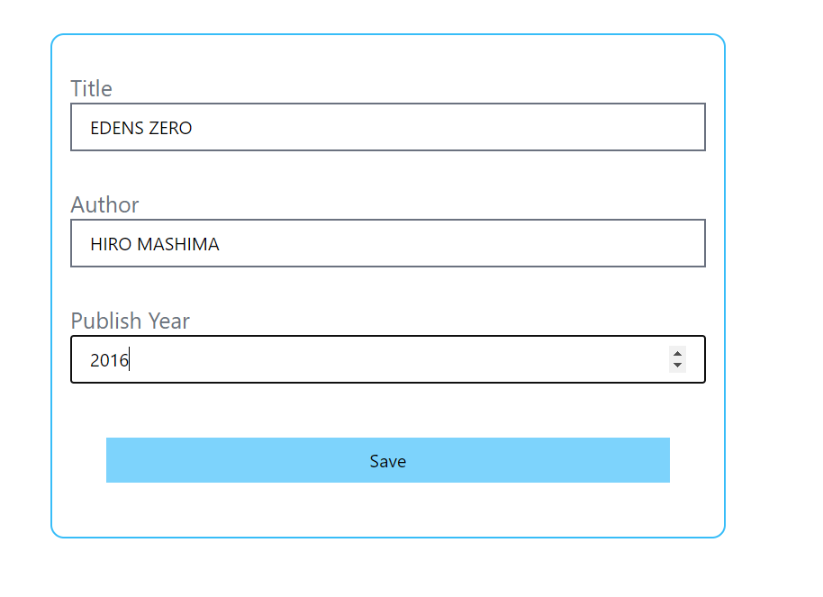
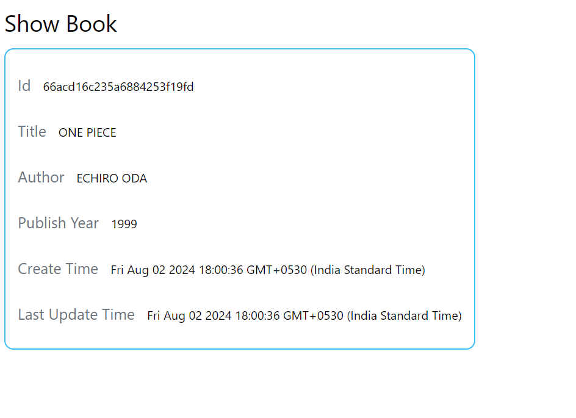
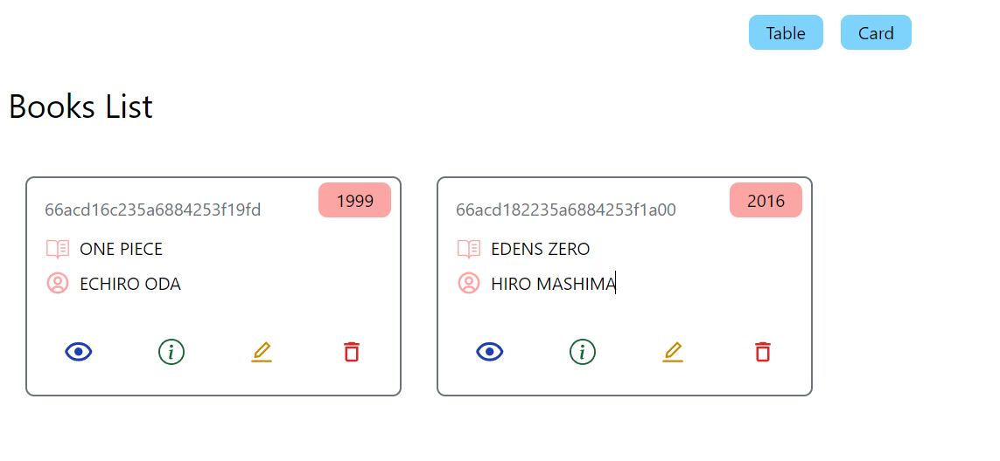
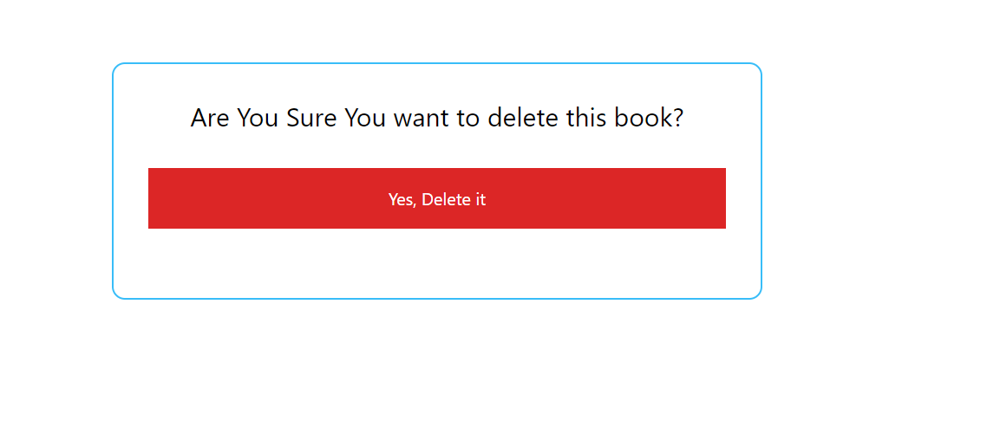
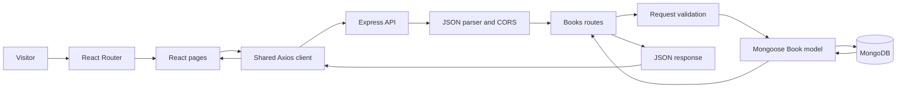
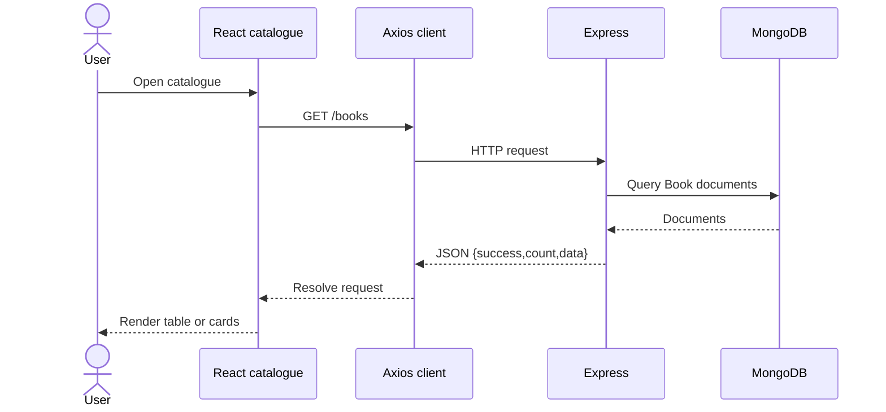
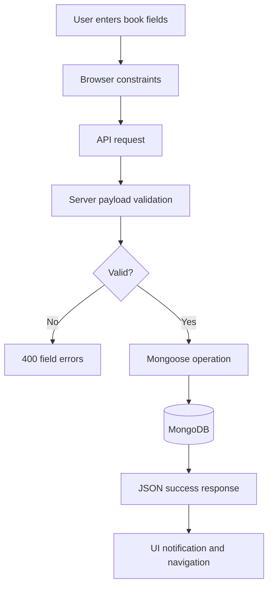
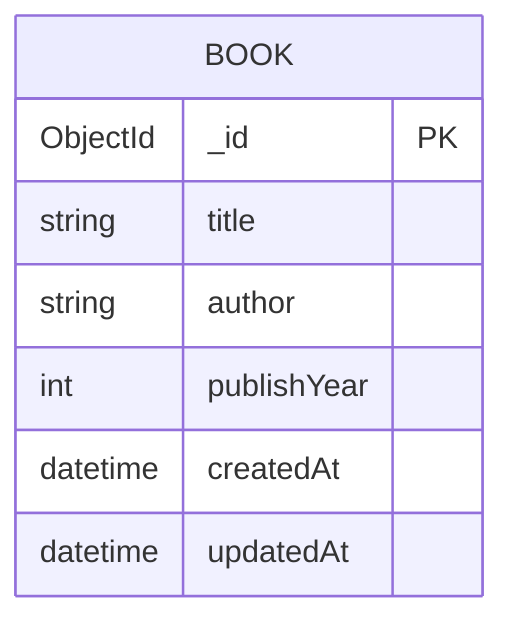

# 📚 Anime Book Store

<div align="center">

**A full-stack book catalogue built with React, Express, and MongoDB**

[](https://react.dev/)
[](https://vitejs.dev/)
[](https://expressjs.com/)
[](https://www.mongodb.com/)
[](./LICENSE)
[](https://github.com/Brajesh31/Anime-Book-Store/actions/workflows/ci.yml)

</div>

Anime Book Store is a CRUD application for maintaining a small book catalogue. Browse records in table or card layouts, create a book, inspect its details, edit its metadata, and permanently delete it. The browser application is built with React and Vite. The REST API uses Express, Mongoose, and MongoDB.

> **Scope note:** Despite the repository name, this version is a catalogue manager. It does not currently implement anime metadata integration, user accounts, shopping cart, checkout, payment, orders, inventory, shipping, or reviews.

---

## 🧭 Contents

- [Overview](#-overview)
- [Current functionality](#-current-functionality)
- [Technology stack](#-technology-stack)
- [Screenshots](#-screenshots)
- [Architecture](#-architecture)
- [Request and user workflows](#-request-and-user-workflows)
- [Repository structure](#-repository-structure)
- [Getting started](#-getting-started)
- [Environment configuration](#-environment-configuration)
- [API reference](#-api-reference)
- [Data model](#-data-model)
- [Quality checks](#-quality-checks)
- [Security and limitations](#-security-and-limitations)
- [Documentation](#-documentation)
- [Contributing](#-contributing)
- [License](#-license)

## 🎯 Overview

The project demonstrates a simple full-stack data-management workflow. The React client provides the user interface. Axios sends JSON requests to the Express API. The API validates incoming fields and uses the Mongoose Book model to read and write MongoDB documents.

### Goals

1. Provide a central catalogue for book records.
2. Demonstrate CRUD operations across browser, API, and database layers.
3. Keep request validation and persistence rules explicit.
4. Provide visible loading, empty, success, and error feedback.
5. Establish documentation and CI checks that make the code easier to maintain.

### Current book fields

| Field | Meaning | Validation |
|---|---|---|
| `title` | Book title | Required, trimmed, max 180 chars |
| `author` | Author name | Required, trimmed, max 120 chars |
| `publishYear` | Publication year | Integer from 0 through 2100 |
| `_id` | MongoDB record identifier | Generated by MongoDB |
| `createdAt` | Creation timestamp | Managed by Mongoose |
| `updatedAt` | Last update timestamp | Managed by Mongoose |

## ✨ Current functionality

| Feature | User outcome | Implementation |
|---|---|---|
| Catalogue | Browse all stored books | `GET /books` |
| Table layout | Scan records in rows | `BooksTable` |
| Card layout | Browse records in responsive cards | `BooksCard` and `BookSingleCard` |
| Preview | Inspect core fields in a dialog | `BookModal` |
| Create | Add a book to the catalogue | `POST /books` |
| Details | View one record and timestamps | `GET /books/:id` |
| Edit | Update the editable fields | `PUT /books/:id` |
| Delete | Confirm and permanently remove a record | `DELETE /books/:id` |
| Health | Check database readiness | `GET /health` |
| Feedback | See loading, empty, error, and notification states | Shared components and Notistack |

### Browser routes

| Path | Page |
|---|---|
| `/` | Catalogue |
| `/books/create` | Create book |
| `/books/details/:id` | Book details |
| `/books/edit/:id` | Edit book |
| `/books/delete/:id` | Delete confirmation |
| `*` | Not-found page |

## 🛠️ Technology stack

| Layer | Technology | Responsibility |
|---|---|---|
| UI | React 18 | Components and local state |
| Build | Vite 5 | Development server and production bundle |
| Navigation | React Router 6 | Client-side routes |
| HTTP | Axios | Shared API client |
| Notifications | Notistack | Success/error messages |
| Icons | React Icons | Interface iconography |
| Styling | Tailwind CSS 3 | Utility-first styling |
| Runtime | Node.js ES modules | Backend runtime |
| API | Express 4 | HTTP routing and middleware |
| ODM | Mongoose 7 | Schema and MongoDB operations |
| Database | MongoDB | Document persistence |
| Backend development | Nodemon | Automatic process restart |
| Backend tests | Node built-in test runner | Request validation unit tests |
| Frontend quality | ESLint | Static analysis |

Versions reflect the checked-in manifests and lockfiles. They are not a claim that the dependencies are the latest available releases.

## 🖼️ Screenshots

The repository includes four existing demo images. They are preserved and referenced below.

| Catalogue preview | Demo 2 |
|---|---|
|  |  |

| Demo 3 | Demo 4 |
|---|---|
|  |  |

## 🏗️ Architecture

The application follows a browser client, API, and database structure.



### Responsibilities

- **Frontend pages** own screen state and user journeys.
- **Shared components** own reusable form, loading, error, empty, table, card, and modal presentation.
- **Axios client** owns the public API base URL, timeout, JSON headers, and error-message extraction.
- **Express application** owns middleware, health checks, route registration, startup, and graceful shutdown.
- **Books router** owns HTTP status codes and CRUD behavior.
- **Request validator** enforces the accepted public payload.
- **Mongoose model** defines persisted data constraints.
- **MongoDB** stores book documents.

### Catalogue request sequence



### Create/update/delete lifecycle



## 🗂️ Repository structure

The following tree highlights first-party files. Generated npm dependency contents and binary assets are not expanded.

```text
Anime-Book-Store/
├── .github/
│   ├── ISSUE_TEMPLATE/
│   ├── workflows/
│   └── PULL_REQUEST_TEMPLATE.md
├── backend/
│   ├── models/bookModel.js
│   ├── routes/booksRoute.js
│   ├── tests/bookValidation.test.js
│   ├── utils/bookValidation.js
│   ├── config.js
│   ├── index.js
│   ├── package.json
│   └── package-lock.json
├── frontend/
│   ├── src/
│   │   ├── components/
│   │   │   ├── home/
│   │   │   ├── BookForm.jsx
│   │   │   ├── FeedbackState.jsx
│   │   │   ├── BackButton.jsx
│   │   │   └── Spinner.jsx
│   │   ├── lib/api.js
│   │   ├── pages/
│   │   ├── styles/
│   │   ├── App.jsx
│   │   ├── index.css
│   │   └── main.jsx
│   ├── index.html
│   ├── package.json
│   └── package-lock.json
├── DEMO/
├── docs/
├── .env.example
├── .eslintrc.cjs
├── .editorconfig
├── .gitattributes
├── .gitignore
├── CHANGELOG.md
├── CITATION.cff
├── CODEOWNERS
├── CODE_OF_CONDUCT.md
├── CONTRIBUTING.md
├── LICENSE
├── README.md
├── ROADMAP.md
├── SECURITY.md
└── SUPPORT.md
```

See [docs/project-structure.md](./docs/project-structure.md) for the detailed file responsibility map.

## 🚀 Getting started

### Prerequisites

- Git.
- Node.js compatible with the project dependencies. CI currently uses Node 20.
- npm.
- A local MongoDB service or an authorized development database.
- A modern browser.

### 1. Clone the repository

```bash
git clone https://github.com/Brajesh31/Anime-Book-Store.git
cd Anime-Book-Store
```

### 2. Configure the backend environment

Copy the safe example file:
```bash
cp .env.example .env
```

Set `MONGODB_URI` in the root `.env` to a database you own and are authorized to use. The example points to local MongoDB. Keep the real `.env` file out of Git.

> [!CAUTION]
> A MongoDB URI containing credentials was previously committed in repository history. Treat the old credential as compromised. Rotate/revoke it with the database provider, review access logs, and never reuse it. Changing the current source file does not invalidate the old database credential or erase historical commits.

### 3. Install and start the backend

```bash
cd backend
npm ci
npm run dev
```

The API defaults to port 5555 and waits for MongoDB to connect before listening.

Check service status:
```bash
curl http://localhost:5555/
curl http://localhost:5555/health
```

### 4. Install and start the frontend

Open a second terminal from the repository root:
```bash
cd frontend
npm ci
npm run dev
```

Vite normally serves at `http://localhost:5173`. If it selects a different port, update `CORS_ORIGIN` in the root `.env` and restart the backend.

For complete setup instructions, read [docs/installation.md](./docs/installation.md).

## ⚙️ Environment configuration

| Variable | Default/example | Purpose |
|---|---|---|
| `PORT` | `5555` | Backend listener |
| `MONGODB_URI` | Local MongoDB URI | Database connection |
| `CORS_ORIGIN` | `http://localhost:5173` | Comma-separated browser origins |
| `VITE_API_BASE_URL` | `http://localhost:5555` | Public frontend API origin |

The backend reads simple key/value values from the root `.env` file when present. Host environment variables take precedence. Vite variables are public in the browser bundle. Never put database credentials, private tokens, or signing keys in a `VITE_*` variable.

Full details: [Configuration and secrets](./docs/configuration.md).

## 🔌 API reference

Local base URL: `http://localhost:5555`.

| Method | Endpoint | Purpose |
|---|---|---|
| GET | `/` | API welcome metadata |
| GET | `/health` | Database readiness |
| GET | `/books` | List all books |
| GET | `/books/:id` | Read one book |
| POST | `/books` | Create a book |
| PUT | `/books/:id` | Replace editable fields |
| DELETE | `/books/:id` | Permanently delete a book |

Example request body:
```json
{
  "title": "Example Volume",
  "author": "Example Author",
  "publishYear": 2024
}
```

The API rejects unknown fields, trims text, enforces field lengths, validates integer year values, and checks MongoDB ObjectId syntax. PUT requires all three editable fields. The list endpoint currently returns the full collection; pagination and search are not implemented.

See the complete [API contract](./docs/api/README.md).

## 🗃️ Data model



The model has no current relationships to users, orders, inventory, genres, or reviews. See [docs/data-model.md](./docs/data-model.md) and [docs/database.md](./docs/database.md).

## 🧪 Quality checks

Backend unit tests:
```bash
cd backend
npm ci
npm test
```

Frontend lint and build:
```bash
cd frontend
npm ci
npm run lint
npm run build
```

The backend test suite currently covers the pure request-validation utility. It does not yet test Express routes against MongoDB. The frontend has lint/build checks but no browser end-to-end test suite. Read [docs/testing.md](./docs/testing.md) for the complete test matrix and release gates.

## 🔐 Security and known limitations

- The previously committed MongoDB credential must be rotated/revoked at the provider. Git history may still contain the old value.
- The API does not implement user authentication or authorization.
- CORS is a browser-origin policy, not an access-control system.
- No cart, checkout, payment, orders, inventory, or customer accounts are implemented.
- The catalogue list is not paginated.
- No search/filter/sort UI is implemented.
- Full API integration and browser end-to-end tests remain future work.\n- The current npm audit workflows report high and critical advisories in both dependency trees. Dependency remediation is required before treating the CI security gate as passing.
- The repository contains historically tracked `node_modules` directories. Remove them only in a separate reviewed cleanup after verifying lockfile installs.

Do not treat the current application as production-ready for public writes. See [SECURITY.md](./SECURITY.md) and [docs/deployment.md](./docs/deployment.md).

## 🧭 Roadmap

Security and reliability work take priority over new product features. See [ROADMAP.md](./ROADMAP.md) for prioritized work and completion criteria.

## 📚 Documentation

| Guide | Contents |
|---|---|
| [Project overview](./docs/project-overview.md) | Goals, actors, scope, constraints |
| [Architecture](./docs/architecture.md) | Modules, request sequence, trust boundaries |
| [Project structure](./docs/project-structure.md) | File-by-file responsibilities |
| [Features](./docs/features.md) | User journeys and implemented capabilities |
| [Installation](./docs/installation.md) | First-time setup |
| [Development](./docs/development.md) | Daily workflow |
| [API quick reference](./docs/api.md) | Endpoint index |
| [Full API reference](./docs/api/README.md) | Payloads and response contract |
| [Data model](./docs/data-model.md) | Schema and lifecycle |
| [Database](./docs/database.md) | Access, backup and operations |
| [Configuration](./docs/configuration.md) | Environment variables and secrets |
| [Testing](./docs/testing.md) | Automated and planned checks |
| [Deployment](./docs/deployment.md) | Production operations |
| [Troubleshooting](./docs/troubleshooting.md) | Diagnostics |
| [FAQ](./docs/faq.md) | Common questions |

## 🤝 Contributing

Read [CONTRIBUTING.md](./CONTRIBUTING.md), follow the pull request template, and include actual test results. Never commit secrets, generated dependencies, build output, or private data.

## 📄 License

Distributed under the [MIT License](./LICENSE).

Maintained by **Brajesh Kumar**: [GitHub @Brajesh31](https://github.com/Brajesh31).

<div align="center">

Made with ❤️ using React, Express, and MongoDB.

</div>
