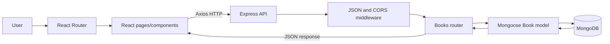
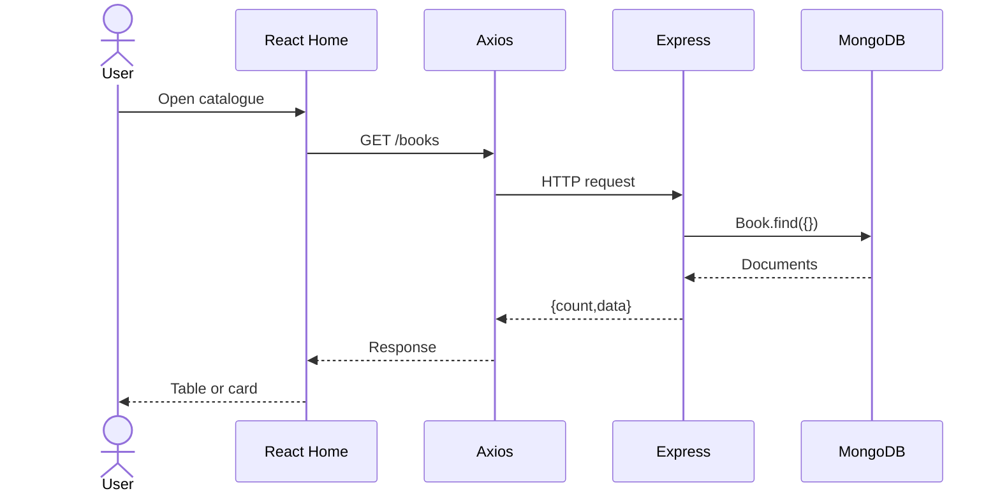
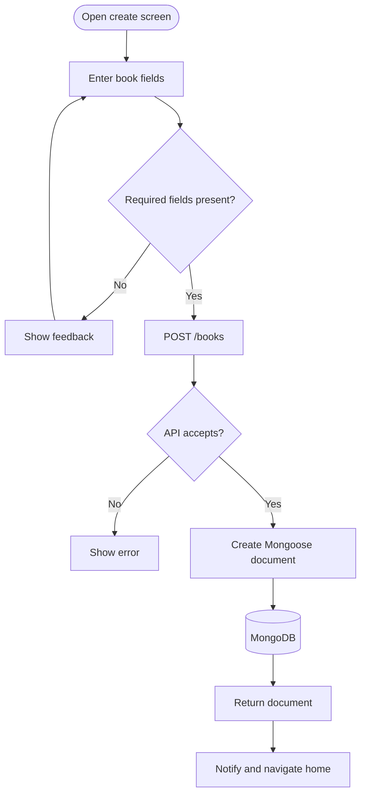
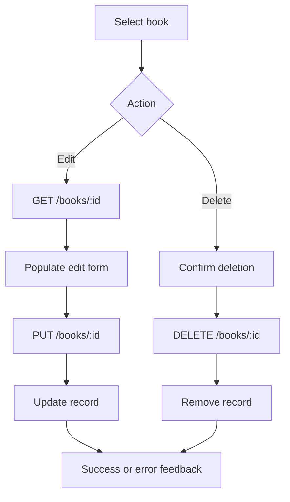
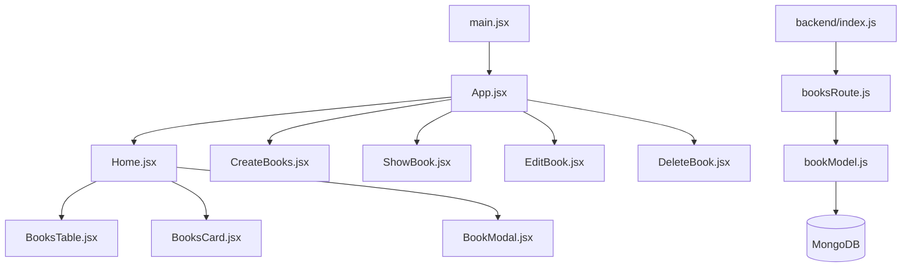
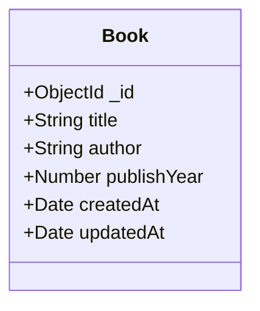

# 📚 Anime Book Store

<div align="center">

**A MERN CRUD application for managing a book catalogue**

[](https://react.dev/)
[](https://vitejs.dev/)
[](https://expressjs.com/)
[](https://www.mongodb.com/)
[](./LICENSE)
[](https://github.com/Brajesh31/Anime-Book-Store/actions/workflows/ci.yml)

</div>

## 🧭 Contents
- [Overview](#-overview)
- [Current features](#-current-features)
- [Technology stack](#-technology-stack)
- [Screenshots](#-screenshots)
- [Architecture and workflows](#-architecture-and-workflows)
- [Project structure](#-project-structure)
- [Setup](#-setup)
- [API reference](#-api-reference)
- [Data model](#-data-model)
- [Validation](#-validation)
- [Security](#-security)
- [Known limitations](#-known-limitations)
- [Documentation](#-documentation)
- [Contributing](#-contributing)

## 🎯 Overview

Anime Book Store is a full-stack JavaScript application for maintaining a book catalogue. The current implementation is a CRUD learning project: records are stored in MongoDB, an Express server exposes JSON endpoints, and a React single-page application provides table and card views with dedicated create, detail, edit, and delete screens.

The schema currently stores generic book metadata: title, author, and publication year, plus MongoDB identity and Mongoose timestamps. Despite the repository name, there is no implemented shopping cart, payment, inventory engine, customer account system, or anime metadata integration.

## ✨ Current features

| Capability | Current implementation |
|---|---|
| Catalogue | Fetch all records from `GET /books` |
| Table/card views | Switch catalogue presentation |
| Create | Submit title, author, publication year |
| Details | Display one record and timestamps |
| Edit | Load and update a record |
| Delete | Confirmation screen and delete request |
| Navigation | React Router browser routes |
| Feedback | Notistack notifications and spinner |
| Persistence | MongoDB through Mongoose |

### Browser routes

| Path | Screen |
|---|---|
| `/` | Catalogue |
| `/books/create` | Create |
| `/books/details/:id` | Details |
| `/books/edit/:id` | Edit |
| `/books/delete/:id` | Delete confirmation |

## 🛠️ Technology stack

| Layer | Technology | Role |
|---|---|---|
| Frontend | React 18 | UI and local state |
| Tooling | Vite 5 | Development/build |
| Navigation | React Router 6 | Client routes |
| HTTP | Axios | Browser API requests |
| Notifications | Notistack | User feedback |
| Icons | React Icons | UI icons |
| Styling | Tailwind CSS 3 | Utility styling |
| Backend | Node.js ES modules | Server runtime |
| API | Express 4 | HTTP routing |
| Database | MongoDB | Persistence |
| ODM | Mongoose 7 | Schema/database operations |
| Development | Nodemon | Server restart |

Versions reflect the checked-in package manifests.

## 🖼️ Screenshots

These four images already exist in the repository and are preserved.

| Demo 1 | Demo 2 |
|---|---|
|  |  |

| Demo 3 | Demo 4 |
|---|---|
|  |  |

## 🏗️ Architecture and workflows

The application uses a browser client, JSON API, Mongoose model, and MongoDB.



### Catalogue request



### Create flow



### Update/delete flow



### Component relationships



## 🗂️ Project structure

The tree highlights first-party source and omits generated dependency contents.

```text
Anime-Book-Store/
├── .github/
│   ├── ISSUE_TEMPLATE/
│   ├── workflows/
│   └── PULL_REQUEST_TEMPLATE.md
├── DEMO/                       # Existing screenshots
├── docs/                       # Engineering documentation
│   ├── api/
│   ├── architecture.md
│   ├── configuration.md
│   ├── data-model.md
│   ├── deployment.md
│   ├── development.md
│   ├── features.md
│   ├── project-overview.md
│   ├── project-structure.md
│   ├── testing.md
│   └── troubleshooting.md
├── backend/
│   ├── config.js
│   ├── index.js
│   ├── models/bookModel.js
│   └── routes/booksRoute.js
├── frontend/
│   ├── index.html
│   ├── package.json
│   └── src/
│       ├── App.jsx
│       ├── components/
│       └── pages/
├── .env.example
├── .editorconfig
├── .gitignore
├── CHANGELOG.md
├── CODE_OF_CONDUCT.md
├── CONTRIBUTING.md
├── LICENSE
├── README.md
├── ROADMAP.md
├── SECURITY.md
└── SUPPORT.md
```

For file-by-file responsibilities, see [Project Structure](./docs/project-structure.md).

## 🚀 Setup

### Prerequisites
- Node.js and npm compatible with the checked-in dependencies.
- MongoDB local instance or Atlas cluster.
- Git.

### Clone
```bash
git clone https://github.com/Brajesh31/Anime-Book-Store.git
cd Anime-Book-Store
```

### Backend
**Security warning:** a credential-bearing MongoDB URI was found in the previously tracked backend configuration. Treat it as compromised. Rotate the database credential in the provider, revoke the old credential, and do not reuse it.

The root `.env.example` documents intended settings, but the current backend does not yet load those variables. Do not treat that file as active configuration until runtime loading is implemented.

```bash
cd backend
npm ci
npm run dev
```

The current server listens on port `5555` after MongoDB connects. Use a safe local configuration.

### Frontend
In a second terminal:

```bash
cd frontend
npm ci
npm run dev
```

Vite typically serves at `http://localhost:5173`. Current page modules call `http://localhost:5555/books` directly. The `VITE_API_BASE_URL` example is not wired into the current page code.

## 🔌 API reference

Current local base URL: `http://localhost:5555`.

| Method | Endpoint | Purpose |
|---|---|---|
| GET | `/books` | List records |
| GET | `/books/:id` | Read a record |
| POST | `/books` | Create a record |
| PUT | `/books/:id` | Update a record |
| DELETE | `/books/:id` | Delete a record |

Example payload:

```json
{
  "title": "Example Volume",
  "author": "Example Author",
  "publishYear": 2024
}
```

The current create/update handlers check required field presence. Stronger type and range validation, malformed ObjectId handling, and consistent not-found behavior remain hardening tasks. See the detailed [API reference](./docs/api/README.md).

## 🗃️ Data model



The model defines required title, author, and publishYear fields and enables timestamps. No user, order, inventory, or review relationship is currently defined. See [Data Model](./docs/data-model.md).

## 🧪 Validation

Frontend scripts:

```bash
cd frontend
npm run lint
npm run build
npm run preview
```

Backend scripts:

```bash
cd backend
npm start
npm run dev
```

The backend manifest does not define a test script. Exercise CRUD endpoints against a disposable MongoDB database. A successful frontend build does not prove database-backed behavior.

## 🔐 Security

> [!CAUTION]
> A MongoDB URI containing credentials was found in tracked backend configuration. Treat it as compromised: rotate the database password/user, revoke the old credential, remove the secret from active source, and review Git history. Removing a value from the latest file does not erase Git history.

Other current risks include broad CORS, no authentication/authorization, limited request validation, and raw exception messages from API handlers. Do not expose public mutation routes to untrusted users until these risks are addressed.

See [SECURITY.md](./SECURITY.md) and [Configuration and secrets](./docs/configuration.md).

## ⚠️ Known limitations

- No authentication or authorization.
- No cart, checkout, payment, order, or inventory functionality.
- No automated backend test suite.
- No catalogue search or pagination.
- Frontend API origin is hard-coded in page modules.
- Example environment variables are not wired to runtime configuration.
- No production deployment manifest is committed.
- Dependency directories are tracked in Git and should be removed in a separate reviewed cleanup.
- API validation and error handling need hardening.

## 🧭 Roadmap

See [ROADMAP.md](./ROADMAP.md). Planned work is not described as current functionality.

## 📚 Documentation

| Guide | Contents |
|---|---|
| [Project overview](./docs/project-overview.md) | Goals, scope, boundaries |
| [Architecture](./docs/architecture.md) | Components and request paths |
| [Project structure](./docs/project-structure.md) | Directory/file responsibilities |
| [Features](./docs/features.md) | Current CRUD behavior |
| [API](./docs/api/README.md) | Endpoints and payloads |
| [Data model](./docs/data-model.md) | Schema and lifecycle |
| [Configuration](./docs/configuration.md) | Runtime settings and secrets |
| [Development](./docs/development.md) | Local workflow |
| [Testing](./docs/testing.md) | Validation and test gaps |
| [Deployment](./docs/deployment.md) | Production readiness |
| [Troubleshooting](./docs/troubleshooting.md) | Common setup problems |

## 🤝 Contributing

Read [CONTRIBUTING.md](./CONTRIBUTING.md), use the pull request template, and never include credentials or installed dependency folders in commits. Report security issues privately using [SECURITY.md](./SECURITY.md).

## 📄 License and author

Distributed under the [MIT License](./LICENSE).

Maintained by **Brajesh Kumar**: [GitHub @Brajesh31](https://github.com/Brajesh31).

---

<div align="center">

Made with ❤️ using React, Express, and MongoDB.

</div>
