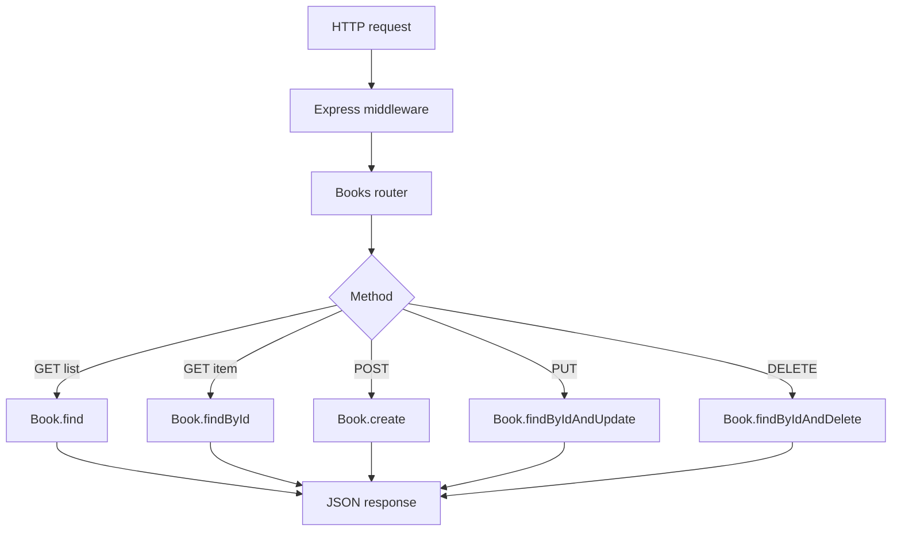

# 🔌 API reference

Current local base URL: `http://localhost:5555`. The router is mounted at `/books`. Authentication middleware is not present in the inspected source.

| Method | Endpoint | Current behavior |
|---|---|---|
| GET | `/books` | Returns `{ count, data }` |
| GET | `/books/:id` | Returns `Book.findById` result |
| POST | `/books` | Requires title, author, publishYear; creates a record (201) |
| PUT | `/books/:id` | Requires fields and updates a matching record |
| DELETE | `/books/:id` | Deletes a matching record |

## Create payload
```json
{"title":"Example Volume","author":"Example Author","publishYear":2024}
```
The current create handler checks property presence and returns 400 when a required value is absent. List responds with `{count,data}`. Read calls `findById`; missing records are not explicitly normalized to 404 and malformed IDs may become 500. Update calls `findByIdAndUpdate(id, request.body)`, returns 404 when no record matches, and otherwise responds with a success message. Passing arbitrary body fields to persistence is a security gap; allow-list fields and enable validators. Delete returns 404 for a missing record.

| Status | Current use |
|---|---|
| 200 | Successful list/read/update/delete |
| 201 | Create |
| 400 | Missing required create/update fields |
| 404 | Missing update/delete record |
| 500 | Caught exception |

Some handlers return raw exception messages. Production APIs should use stable public errors and private detailed logs.

## cURL
```bash
curl http://localhost:5555/books
curl -X POST http://localhost:5555/books -H 'Content-Type: application/json' -d '{"title":"Example Volume","author":"Example Author","publishYear":2024}'
curl http://localhost:5555/books/665000000000000000000001
curl -X PUT http://localhost:5555/books/665000000000000000000001 -H 'Content-Type: application/json' -d '{"title":"Updated Volume","author":"Example Author","publishYear":2025}'
curl -X DELETE http://localhost:5555/books/665000000000000000000001
```
Use disposable records only.



No pagination, filtering, sorting, search, OpenAPI definition, authentication, rate-limit contract, or payment endpoints are present.
