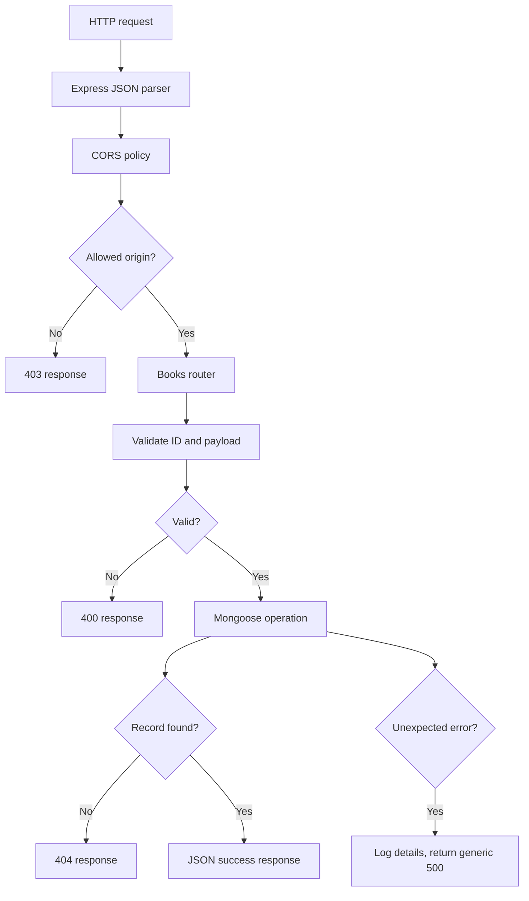

# 🔌 API reference and contract

This document describes the Express API currently implemented by `backend/index.js` and `backend/routes/booksRoute.js`. It is the source of truth for browser/API request behavior. Update it in the same change as route behavior.

## 1. Service overview

| Property | Value |
|---|---|
| Local base URL | `http://localhost:5555` |
| Health endpoint | `GET /health` |
| Resource collection | `/books` |
| Data format | JSON |
| Authentication | Not implemented |
| Transport | HTTP locally; HTTPS required for deployment |
| Persistence | MongoDB through Mongoose |

The API is unauthenticated. Do not expose write endpoints to untrusted users until authentication, authorization, abuse protection, and operational controls have been designed.

## 2. Endpoint catalogue

| Method | Path | Success | Purpose |
|---|---|---:|---|
| GET | `/` | 200 | Service welcome metadata |
| GET | `/health` | 200/503 | API and database readiness |
| GET | `/books` | 200 | Return the current book collection |
| GET | `/books/:id` | 200 | Return one book |
| POST | `/books` | 201 | Create a book |
| PUT | `/books/:id` | 200 | Replace editable book fields |
| DELETE | `/books/:id` | 200 | Permanently delete a book |

## 3. Resource representation

The persisted Book schema currently contains:
- `_id`: MongoDB ObjectId, generated by MongoDB/Mongoose.
- `title`: trimmed string, required, maximum 180 characters.
- `author`: trimmed string, required, maximum 120 characters.
- `publishYear`: integer from 0 through 2100.
- `createdAt`: Mongoose-managed creation timestamp.
- `updatedAt`: Mongoose-managed last-update timestamp.

Clients must not submit `_id`, timestamps, or unknown fields. The server accepts only the three editable properties.

## 4. List books

`GET /books` returns all current records, sorted newest first by `createdAt`.

Example response:
```json
{
  "success": true,
  "count": 1,
  "data": [
    {
      "_id": "665000000000000000000001",
      "title": "Example Volume",
      "author": "Example Author",
      "publishYear": 2024,
      "createdAt": "2024-05-24T10:00:00.000Z",
      "updatedAt": "2024-05-24T10:00:00.000Z"
    }
  ]
}
```

The endpoint currently returns the full collection. Pagination, filtering, search, and sort parameters are not implemented. Large catalogues will require pagination before production scale.

## 5. Read one book

`GET /books/:id` first validates the identifier format. A valid but unknown ObjectId returns 404. An invalid ObjectId returns 400.

Success response:
```json
{
  "success": true,
  "data": {
    "_id": "665000000000000000000001",
    "title": "Example Volume",
    "author": "Example Author",
    "publishYear": 2024,
    "createdAt": "2024-05-24T10:00:00.000Z",
    "updatedAt": "2024-05-24T10:00:00.000Z"
  }
}
```

## 6. Create a book

`POST /books` requires a JSON object with exactly the three editable fields.

Request:
```json
{
  "title": "Example Volume",
  "author": "Example Author",
  "publishYear": 2024
}
```

The API trims text, checks required values, enforces length limits, converts a numeric string to a number, and rejects fractional/out-of-range years or unknown properties. A successful request returns 201 with `success`, `message`, and the created `data` document.

## 7. Update a book

`PUT /books/:id` requires all three editable properties. It is a full replacement of the editable portion of the resource, not a partial PATCH. The API validates the ObjectId, validates the payload, uses an explicit allow-list, enables Mongoose validators, and returns the updated document.

A request that omits one required field returns 400. A valid ID with no matching record returns 404.

## 8. Delete a book

`DELETE /books/:id` permanently removes the selected document. It returns 400 for an invalid ID, 404 when no matching record exists, and 200 with a confirmation message and deleted ID on success. There is no recycle bin or undo endpoint.

## 9. Error response contract

Validation example:
```json
{
  "success": false,
  "message": "The submitted book data is invalid.",
  "errors": {
    "title": "Title is required."
  }
}
```

General error:
```json
{
  "success": false,
  "message": "The requested book was not found."
}
```

| Status | Meaning |
|---:|---|
| 200 | Request completed |
| 201 | Resource created |
| 400 | Invalid ObjectId or request data |
| 403 | Browser origin rejected by CORS |
| 404 | Route or resource not found |
| 500 | Unexpected server failure |
| 503 | Health endpoint reports database unavailable |

The server logs technical error details. The public response intentionally avoids returning stack traces or raw database messages.

## 10. cURL examples

List:
```bash
curl http://localhost:5555/books
```

Health:
```bash
curl http://localhost:5555/health
```

Create:
```bash
curl -X POST http://localhost:5555/books \
  -H 'Content-Type: application/json' \
  -d '{"title":"Example Volume","author":"Example Author","publishYear":2024}'
```

Read:
```bash
curl http://localhost:5555/books/665000000000000000000001
```

Update:
```bash
curl -X PUT http://localhost:5555/books/665000000000000000000001 \
  -H 'Content-Type: application/json' \
  -d '{"title":"Revised Volume","author":"Example Author","publishYear":2025}'
```

Delete:
```bash
curl -X DELETE http://localhost:5555/books/665000000000000000000001
```

Use a disposable local database and disposable IDs when running mutation examples.

## 11. Request lifecycle



## 12. Contract evolution rules

When adding a field or endpoint:
1. Define ownership and validation rules.
2. Update the Mongoose schema.
3. Update the request validator and tests.
4. Define response and error behavior.
5. Update frontend form and rendering only where needed.
6. Update this API reference and the data-model guide.
7. Consider migration and compatibility for existing records.
8. Verify security, authorization, and operational implications.

Do not add shopping or payment endpoints as placeholders. Those features require separate domain design and threat modeling.
