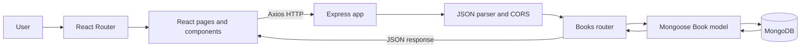
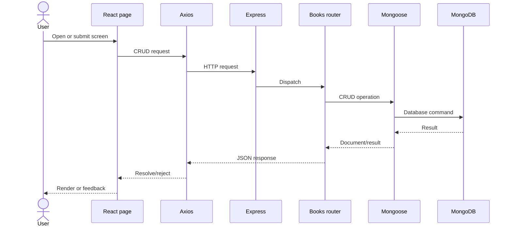
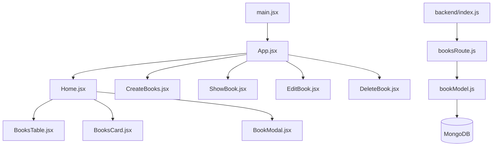

# 🏗️ Architecture and system design

## Architecture
The current application is composed of a React browser client, an Express JSON API, and MongoDB persistence accessed through Mongoose. No separate microservice, queue, cache, identity provider, or payment service is present in the inspected source.

## Frontend responsibilities
`main.jsx` mounts React with BrowserRouter and SnackbarProvider. `App.jsx` maps browser paths to page components. `pages/` contains catalogue, create, detail, edit and delete screens. `components/` contains reusable UI. Axios requests currently use a hard-coded localhost API origin.

## Backend responsibilities
`index.js` initializes Express, JSON parsing and CORS, mounts `/books`, connects MongoDB, then starts listening. `routes/booksRoute.js` implements CRUD handlers. `models/bookModel.js` defines required title, author, publishYear and timestamps. `config.js` contains hard-coded settings and a credential-bearing MongoDB URI. Treat that credential as compromised.

## Request sequence

## Module relationships

## Boundaries
| Boundary | Data | Concern |
|---|---|---|
| Browser to API | Untrusted JSON and IDs | Validate on server |
| Router to model | Fields and identifiers | Allow-list and validate |
| Model to database | Mongoose operations | Connectivity/schema errors |
| API to browser | JSON and errors | Avoid leaking internals |

## Decisions and trade-offs
| Concern | Current choice | Trade-off |
|---|---|---|
| UI | React SPA | Simple; requires API availability |
| Build | Vite | Fast local feedback |
| Navigation | BrowserRouter | Static host needs index.html fallback |
| HTTP | Axios | Promise-based requests |
| API | Express | Direct route handlers |
| Persistence | MongoDB/Mongoose | Document store with schema layer |

The next engineering priorities are secret remediation, environment config, input validation, consistent errors, automated tests, and health checks. Distributed infrastructure is not justified by the current scope.
