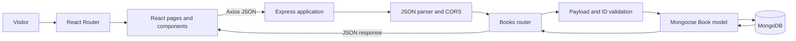
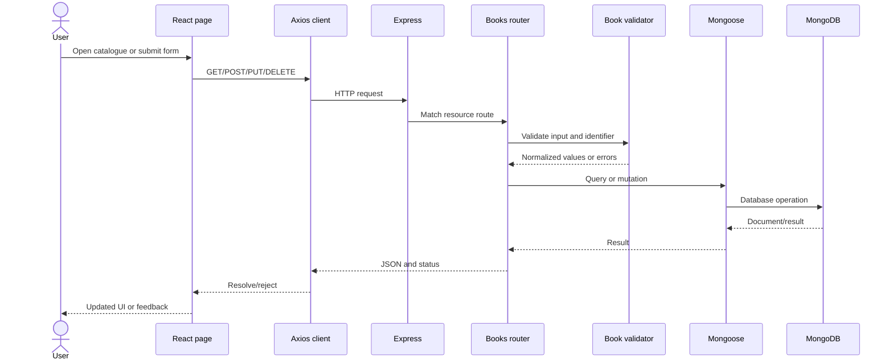

# 🏗️ Architecture and system design

## 1. Architectural summary

Anime Book Store is a small three-part application:
1. React single-page application in `frontend/`.
2. Express JSON API in `backend/`.
3. MongoDB database accessed through Mongoose.

The architecture is a conventional client/API/database design. It is not a microservice platform. There is no queue, cache, payment provider, identity provider, or external anime catalogue integration in the current implementation.

## 2. Frontend architecture

### Entry and providers
`frontend/index.html` contains the document shell and root mount element. `src/main.jsx` mounts React, BrowserRouter, and Notistack. StrictMode is enabled in development to help reveal unsafe side effects.

### Route composition
`src/App.jsx` maps browser paths to page components. Unknown browser paths render a not-found page. BrowserRouter requires a production static host to serve `index.html` as a fallback for valid client-side paths.

| Route | Page | Responsibility |
|---|---|---|
| `/` | Home | Load and display catalogue |
| `/books/create` | CreateBooks | Validate and submit a new book |
| `/books/details/:id` | ShowBook | Inspect a persisted record |
| `/books/edit/:id` | EditBook | Load and update a record |
| `/books/delete/:id` | DeleteBook | Review and delete a record |
| `*` | NotFound | Handle unknown browser paths |

### Shared components
- `BookForm` centralizes create/edit fields and browser-side constraints.
- `FeedbackState` provides consistent empty and error views.
- `Spinner` exposes a textual loading status.
- `BackButton` provides consistent navigation.
- `BooksTable` and `BooksCard` provide alternate catalogue layouts.
- `BookSingleCard` presents one record and its actions.
- `BookModal` offers a compact preview.

### API client
`src/lib/api.js` centralizes Axios base URL, timeout, JSON headers, and error-message extraction. The API origin is configured through `VITE_API_BASE_URL`. Vite variables are public and must never contain secrets.

## 3. Backend architecture

`backend/index.js` configures Express middleware, health and welcome routes, mounts the books router, handles unknown routes, and starts the listener only after MongoDB connects.

`backend/config.js` loads simple key/value settings from the repository-root `.env` file when present. Existing host environment variables take precedence. It validates the port and requires `MONGODB_URI`. A local environment file is not committed.

`backend/routes/booksRoute.js` owns HTTP behavior for the Book resource. It validates ObjectIds and uses the explicit payload validator before database writes.

`backend/utils/bookValidation.js` is the public request contract. It rejects unknown keys and normalizes the accepted fields.

`backend/models/bookModel.js` defines database-level constraints and timestamps. API validation and schema validation are complementary, not interchangeable.

## 4. Request sequence

## 5. Data ownership and trust boundaries

| Boundary | Input | Required control |
|---|---|---|
| Browser to API | URL, JSON body, browser origin | CORS, body-size limit, validation |
| Route to model | ObjectId and allowed fields | ID validation, allow-list |
| Model to database | Mongoose operations | Schema constraints, least privilege |
| API to browser | JSON and error messages | Stable status codes, no stack traces |
| Host to process | Environment variables | Secret management, configuration validation |

CORS is a browser-origin control, not authentication. A client that can call the API outside a browser is not blocked by CORS. Production write access requires authentication and authorization.

## 6. Architectural decisions

| Decision | Current approach | Reason and trade-off |
|---|---|---|
| Frontend | React SPA | Simple UI composition; depends on API availability |
| Build tool | Vite | Fast local development and static output |
| Navigation | BrowserRouter | Clean URLs; requires host fallback |
| HTTP | Shared Axios instance | Central base URL and error handling |
| Backend | Express | Small, explicit REST surface |
| Persistence | MongoDB/Mongoose | Document model and schema validation |
| Validation | Shared server-side utility + schema | Reject invalid and unknown fields |
| Environment | Root .env plus host variables | Keep secrets outside source control |

## 7. Failure behavior

- If configuration is invalid, the backend exits instead of starting with a guessed database.
- If MongoDB cannot connect, the listener does not start.
- If the browser cannot reach the API, the page shows a retryable error state.
- If a record is missing, detail/edit/delete screens show the API's not-found error.
- If an input is invalid, the API returns a 400 response with field-level messages.
- If an unexpected error occurs, the API logs technical detail and returns a generic 500 message.

## 8. Scaling boundaries

The list endpoint currently returns every record. Add pagination before the catalogue becomes large. Search should use deliberate query and index design, not arbitrary client-side filtering over an unbounded collection. Caching is not currently necessary for the small CRUD scope. Background jobs and microservices would add operational cost without a demonstrated need.

## 9. Future architecture gates

Before adding accounts, define identity and ownership. Before adding stock, define inventory invariants and concurrent updates. Before adding orders, define immutable order snapshots and lifecycle transitions. Before adding payments, use a trusted payment provider, verified webhooks, idempotency, and a dedicated threat model. These are future product decisions, not current modules.
