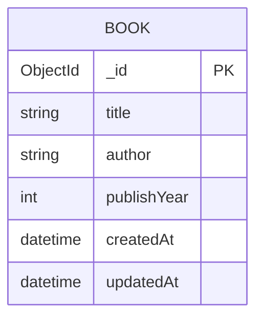
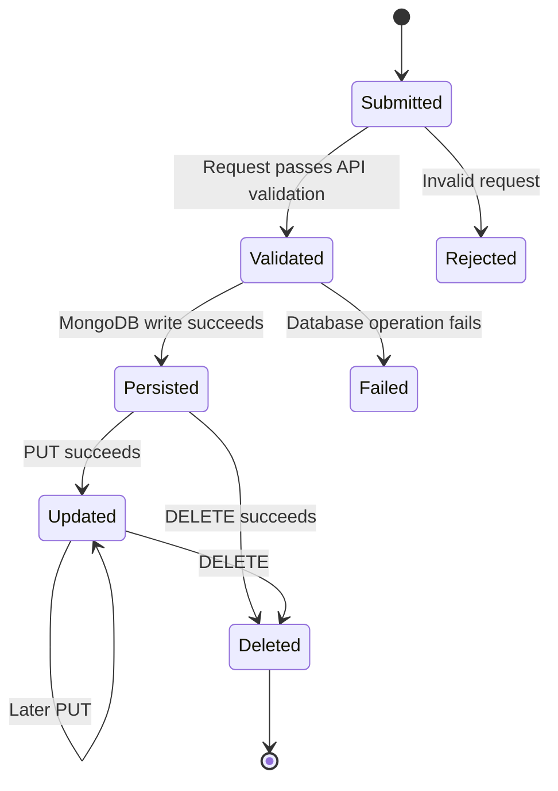

# 🗃️ Data model and persistence

## 1. Current Book entity

The only domain entity currently implemented is `Book`, defined in `backend/models/bookModel.js`. It represents a catalogue record, not an order, product inventory item, user-owned library, or payment record.

| Field | Database type | Required | Constraints | Ownership |
|---|---|---|---|---|
| `_id` | ObjectId | Generated | MongoDB identifier | Database |
| `title` | String | Yes | Trimmed, 1-180 chars | Client input, server validated |
| `author` | String | Yes | Trimmed, 1-120 chars | Client input, server validated |
| `publishYear` | Number | Yes | Integer, 0-2100 | Client input, server validated |
| `createdAt` | Date | Generated | Mongoose timestamp | Server/model |
| `updatedAt` | Date | Generated | Mongoose timestamp | Server/model |

The schema disables the version key and uses strict mode set to throw. The API does not accept caller-supplied IDs or timestamps.

## 2. Entity diagram



There are no user, category, author-reference, order, review, stock, or payment relationships in the current model.

## 3. Example document

```json
{
  "_id": "665000000000000000000001",
  "title": "Example Volume",
  "author": "Example Author",
  "publishYear": 2024,
  "createdAt": "2024-05-24T10:00:00.000Z",
  "updatedAt": "2024-05-24T10:00:00.000Z"
}
```
This is illustrative data, not a real database record.

## 4. Validation layers

The API validator in `backend/utils/bookValidation.js`:
- Requires a JSON object, not an array or null.
- Rejects keys outside the editable Book contract.
- Trims title and author.
- Rejects empty text.
- Enforces title and author maximum lengths.
- Converts numeric strings to numbers.
- Requires an integer publication year in the supported range.

Mongoose repeats important constraints as a persistence safeguard. Database-level validation does not replace request validation because the API should return predictable field errors before attempting a write.

## 5. Lifecycle



The current API does not implement soft delete, archive state, audit history, or restoration.

## 6. Query and index behavior

The list endpoint currently performs `Book.find({}).sort({ createdAt: -1 }).lean()`. A compound index on title and author is declared for likely exact lookup/sorting extensions, but the current list route does not expose a search endpoint. Index additions should be based on observed query patterns and validated with explain plans.

The list route returns every document. Pagination is a required future improvement before the catalogue grows substantially.

## 7. Schema evolution policy

For every new field:
1. Define meaning, nullability, ownership, defaults, and allowed values.
2. Decide whether existing documents need a backfill.
3. Add API validation and Mongoose schema rules.
4. Update frontend forms and views.
5. Add tests for valid, invalid, missing, and legacy records.
6. Update API, database, and data-model documentation.
7. Consider index size and query performance.
8. Document rollout and rollback behavior.

## 8. Potential future fields

ISBN, genre, description, cover image URL, language, series, volume number, and publication date may be useful for a richer catalogue. They are not present now. Before adding cover URLs, define safe URL schemes and image-host policy. Before adding genres, decide between a controlled enum and a separate collection. Before adding volume/series relationships, define canonical identifiers.

Price, stock, cart, order, and payment data belong to a commerce domain design. They should not be appended casually to this simple catalogue schema.
