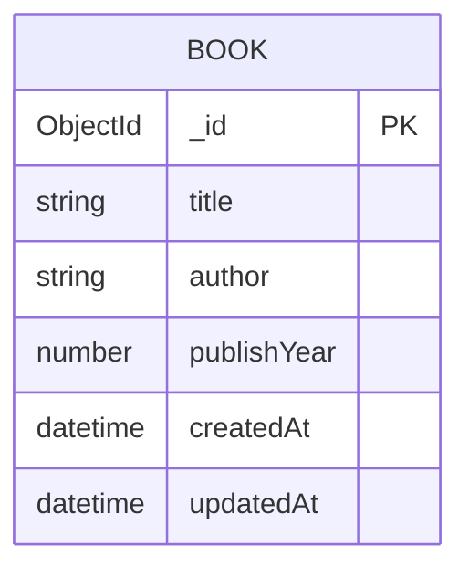

# Data model and persistence

The Mongoose `Book` model is defined in `backend/models/bookModel.js`.

| Field | Type | Required | Meaning |
|---|---|---|---|
| `_id` | ObjectId | Generated | Record identity |
| `title` | String | Yes | Book title |
| `author` | String | Yes | Author name |
| `publishYear` | Number | Yes | Publication year |
| `createdAt` | Date | Generated | Creation timestamp |
| `updatedAt` | Date | Generated | Last update timestamp |

The schema enables timestamps. No custom indexes, relationships, enums, text search, or explicit bounds are present.



Example only:
```json
{"_id":"665000000000000000000001","title":"Example Volume","author":"Example Author","publishYear":2024,"createdAt":"2024-05-24T10:00:00.000Z","updatedAt":"2024-05-24T10:00:00.000Z"}
```

POST calls `Book.create`; list calls `Book.find({})`; read calls `Book.findById`; update calls `Book.findByIdAndUpdate`; delete calls `Book.findByIdAndDelete`.

Validation improvements: trim/reject blank text, enforce string lengths/year bounds, reject unknown properties, validate ObjectIds, allow-list update fields, enable update validators, and normalize 400/404 responses. Current update passes request body directly to Mongoose. ISBN, genre, description, cover URL, price, stock, and owner are not current fields and require deliberate schema/migration design before introduction.
