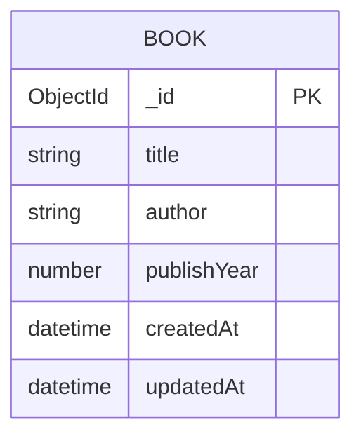

# 🗃️ Data model and persistence

The Mongoose `Book` model lives in `backend/models/bookModel.js`.

| Field | Type | Required | Meaning |
|---|---|---|---|
| `_id` | ObjectId | Generated | Record identity |
| `title` | String | Yes | Book title |
| `author` | String | Yes | Author name |
| `publishYear` | Number | Yes | Publication year |
| `createdAt` | Date | Generated | Creation timestamp |
| `updatedAt` | Date | Generated | Last update timestamp |

The schema enables timestamps. No custom indexes, relationships, enums, text search, or explicit value bounds are present.



Illustrative document only:
```json
{
  "_id": "665000000000000000000001",
  "title": "Example Volume",
  "author": "Example Author",
  "publishYear": 2024,
  "createdAt": "2024-05-24T10:00:00.000Z",
  "updatedAt": "2024-05-24T10:00:00.000Z"
}
```

POST uses `Book.create`; list uses `Book.find({})`; read uses `Book.findById`; update uses `Book.findByIdAndUpdate`; delete uses `Book.findByIdAndDelete`.

Validation improvements: trim/reject blank text, enforce string lengths and year bounds, reject unknown fields, validate ObjectIds, allow-list update fields, enable update validators, and normalize 400/404 responses. The current update route passes the request body directly to Mongoose.

ISBN, genre, description, cover URL, price, stock, and owner are not current fields. Each requires explicit requirements, validation and migration design before introduction.
