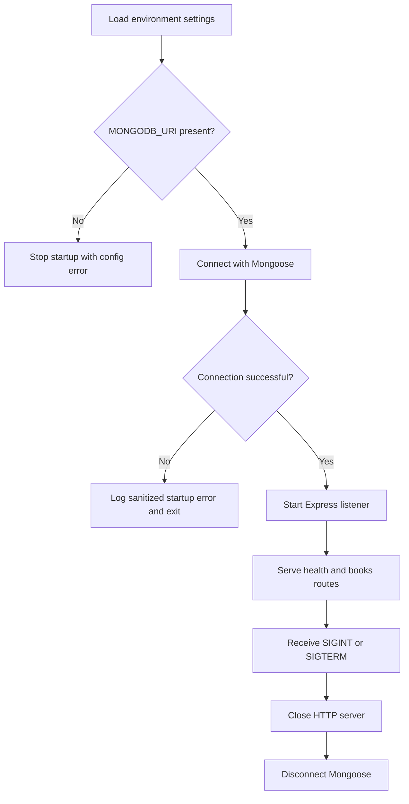

# 🗄️ Database operations and data stewardship

## 1. Database technology

The backend uses MongoDB and Mongoose. The connection URI is supplied through `MONGODB_URI`; it must never be committed to source control. The application starts its HTTP listener only after a successful database connection.

## 2. Local database

A local MongoDB instance can use the example database name:
```text
mongodb://127.0.0.1:27017/anime_book_store
```
The database is created by MongoDB when the first document is written. Use a disposable local dataset for development and route tests.

## 3. Connection lifecycle



## 4. Collection and document design

Mongoose maps the `Book` model to its MongoDB collection. The model has title, author, publishYear and automatic timestamps. See [data-model.md](./data-model.md) for constraints and examples.

## 5. Access control

Use a separate database user for each environment. The API user should have only the permissions needed for the application database. Avoid cluster-wide administrator credentials in application configuration. Rotate credentials when a contributor leaves or an exposure is suspected.

## 6. Backups and restore

A production owner should define:
- Backup schedule and retention.
- Encryption at rest and in transit.
- Who can access backups.
- Restore test frequency.
- Recovery point objective (RPO).
- Recovery time objective (RTO).
- Data deletion and retention requirements.

A backup is not proven until a restore has been tested. The repository does not currently automate backups or define RPO/RTO targets.

## 7. Indexes and performance

The schema declares a compound title/author index. The list endpoint currently reads the full collection and sorts by creation time. Measure real query plans before adding indexes. Indexes consume storage and add write overhead. Pagination and bounded query sizes should be implemented before large datasets are used.

## 8. Data integrity

Do not manually edit production documents without an approved procedure. For data corrections, capture the reason, affected record identifiers, backup/restore plan, and verification query. Do not commit database dumps or sample files containing real personal data.

## 9. Credential exposure response

A credential-bearing MongoDB URI was found in repository history. Treat the old credential as compromised. Rotate/revoke it with the database provider and inspect access logs. Removing the URI from the latest branch is necessary but does not erase historical copies. Never reproduce credentials in this guide.

## 10. Operational checklist

- [ ] Separate local, preview, and production databases.
- [ ] Use least-privilege credentials.
- [ ] Store credentials in host secret settings.
- [ ] Restrict network access to expected hosts.
- [ ] Configure TLS.
- [ ] Define backup and retention policy.
- [ ] Test restore procedures.
- [ ] Monitor connection failures and query latency.
- [ ] Keep database URIs out of logs and Git.
