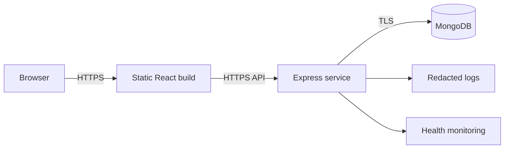

# 🚀 Deployment and operations

## Current state
No production deployment manifest or infrastructure configuration is present in the inspected source. A local development run is not a production release.

## Suggested topology

This is a target architecture, not an environment currently provisioned by this repository.

## Frontend build
```bash
cd frontend
npm ci
npm run build
```
Deploy `frontend/dist`. The app uses BrowserRouter, so the static host must fall back to `index.html` for application routes while preserving real asset paths.

## Backend runtime
```bash
cd backend
npm ci --omit=dev
npm start
```
Before deployment, replace hard-coded settings with validated runtime environment variables and rotate the committed database credential.

## Production controls
- Rotate and revoke exposed database credentials.
- Load secrets from host-managed environment settings.
- Restrict CORS to the deployed frontend origin.
- Validate IDs and every request field.
- Add authentication and authorization if public users must not mutate data.
- Add health/readiness checks and redacted structured logs.
- Configure TLS, security headers, rate limits and request size limits.
- Configure process restart policy, backups and restore exercises.
- Define release ownership and rollback.

Use separate least-privilege databases/users for local, preview and production. Never put private secrets in Vite `VITE_*` variables.

## Release checklist
- [ ] CI passes on release commit.
- [ ] Frontend artifact reviewed.
- [ ] Backend starts with production configuration.
- [ ] Database connection verified.
- [ ] CORS, TLS and SPA fallback verified.
- [ ] Logs redact secrets and personal data.
- [ ] Backup, restore and rollback exercised.
