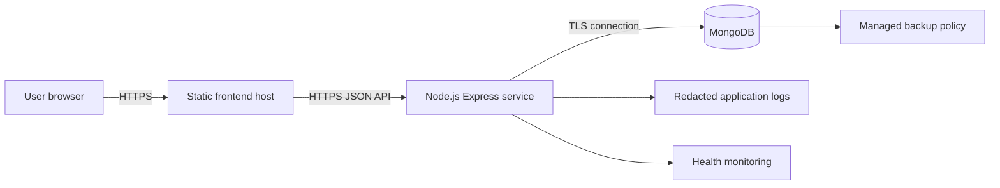
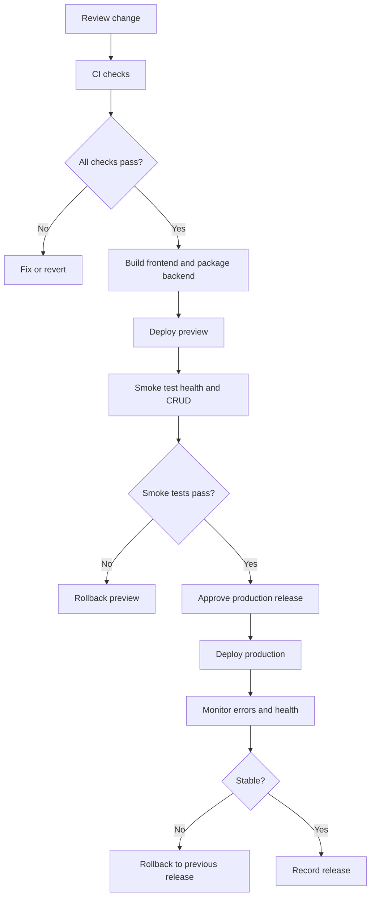

# 🚀 Deployment and operations guide

## Deployment status
The repository contains application source and GitHub Actions workflows, but no committed infrastructure manifest, container image, process manager configuration, or production host declaration. The topology below is a recommended pattern, not a claim that a live environment exists.

## Recommended topology



The frontend and API may be hosted separately. The browser must use the public API origin, and the API must allow the exact frontend origin.

## Pre-deployment security gate
A database URI with embedded credentials was previously committed to the repository. Treat that credential as compromised even though the active configuration has since been changed.

1. Rotate or replace the database password/user in the provider.
2. Revoke the old credential.
3. Review provider access logs for unexpected connections.
4. Add the replacement URI only to host-managed secret settings.
5. Verify current source and CI logs do not reveal the URI.
6. Review Git history and decide whether coordinated history cleanup is required.

Do not deploy using the exposed credential.

## Frontend build
```bash
cd frontend
npm ci
npm run lint
npm run build
```
Deploy `frontend/dist`. Configure SPA fallback so paths such as `/books/details/:id` return `index.html`. Do not rewrite missing JavaScript, CSS, or image assets to HTML.

Set `VITE_API_BASE_URL` at build time to the API's public HTTPS origin. This value is public and must not contain secrets.

## Backend runtime
```bash
cd backend
npm ci --omit=dev
npm start
```
Set `PORT`, `MONGODB_URI`, and `CORS_ORIGIN` in the host environment. The application validates the port and requires a database URI. It starts listening after MongoDB connects. `GET /health` reports 200 when the database is ready and 503 otherwise.

## Network and browser configuration
- Terminate TLS at a trusted host or reverse proxy.
- Permit inbound API traffic only on the required port.
- Restrict MongoDB network access to approved application hosts.
- Use a least-privilege database user.
- Set CORS to explicit browser origins.
- Do not assume CORS protects non-browser API clients.
- Ensure reverse proxies preserve the health route and JSON responses.

## Runtime operations
Production operations should include process restart policy, graceful shutdown, redacted structured logs, health checks, error monitoring, dependency review, backups, tested restore procedures, incident ownership, and documented rollback.

## Data protection
Define backup retention, encryption, restore authorization, RPO, RTO, and deletion policies before storing important data. Never use production database exports as local fixtures.

## Release and rollback flow



## Release checklist
- [ ] Database credential rotated and old credential revoked.
- [ ] Secrets stored in host-managed configuration.
- [ ] CI passes on the exact release commit.
- [ ] Frontend lint and build pass.
- [ ] Backend tests and syntax checks pass.
- [ ] API starts and connects to the intended database.
- [ ] Health endpoint returns ready status.
- [ ] CORS permits only expected origins.
- [ ] HTTPS and SPA fallback verified.
- [ ] CRUD smoke tests pass with disposable/approved records.
- [ ] Logs contain no credentials or private data.
- [ ] Backup, restore, and rollback procedures are understood.
