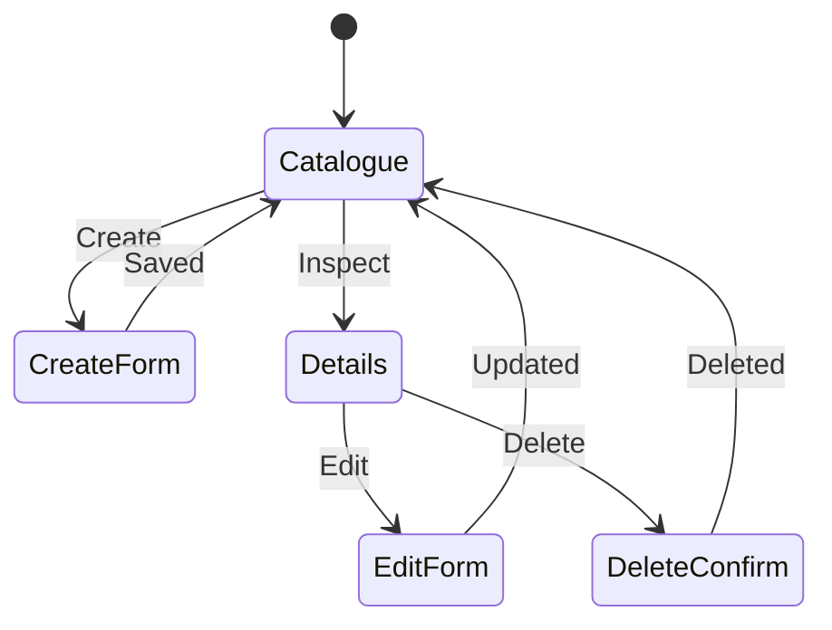

# ✨ Feature specifications

## Catalogue
Source: `frontend/src/pages/Home.jsx`. Requests `GET http://localhost:5555/books`, stores `response.data.data`, and switches between table/card views. It links to `/books/create` and shows a spinner while loading. On failure it logs and stops loading, but no dedicated visible error or empty state is rendered.

## Create
`CreateBooks.jsx` collects `title`, `author`, and `publishYear`, sends POST, shows success feedback, and navigates home. Failures show a generic notification. Field constraints and structured API error display are limited.

## Details
`ShowBook.jsx` fetches by route ID and displays ID, title, author, year, createdAt and updatedAt. Invalid IDs and missing records lack a dedicated not-found experience.

## Edit
`EditBook.jsx` fetches a record, populates local state, then submits PUT. Its effect currently omits the route ID dependency; fetch failure uses a browser alert.

## Delete
`DeleteBook.jsx` asks for confirmation, sends DELETE, displays success and navigates home. A record summary and stronger accidental-delete safeguards could improve this flow.

## Shared components
| Component | Purpose |
|---|---|
| `BackButton` | Return navigation |
| `Spinner` | Loading feedback |
| `BooksTable` | Table view |
| `BooksCard` | Card view |
| `BookSingleCard` | Individual card |
| `BookModal` | Modal presentation |

## User state flow

Cart, checkout, payments, orders, accounts, reviews, recommendations, inventory allocation, and external anime metadata are not implemented in the inspected source.
