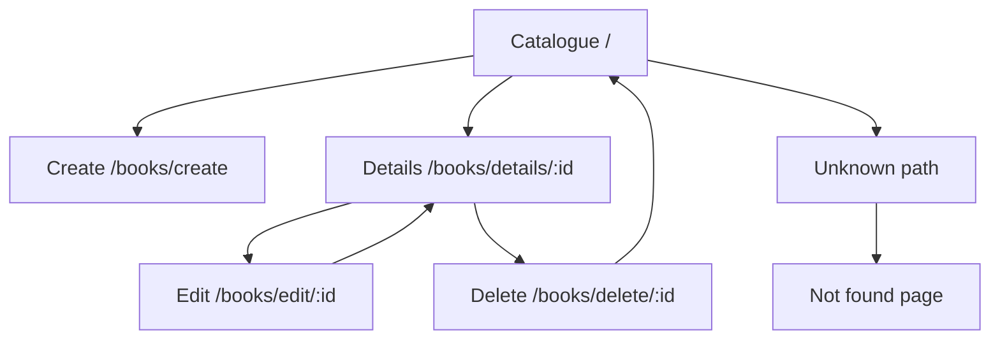

# ✨ Feature specifications and user journeys

This guide describes behavior present in the React pages and Express API. It deliberately separates current functionality from product ideas.

## 1. Catalogue landing page

**Page:** `frontend/src/pages/Home.jsx`

On mount, the page requests `GET /books` through the shared Axios client. It reads the API response's `data` array and renders a count. Users can switch between table and card presentations without changing the underlying collection.

States:
- Loading: accessible spinner and live text.
- Error: message and retry action.
- Empty: explanation and action to create the first record.
- Loaded: catalogue count and selected layout.

The list endpoint currently returns all records. There is no search, pagination, filter, or sort control in the UI.

## 2. Create workflow

**Page:** `CreateBooks.jsx`, shared component: `BookForm.jsx`

The form collects title, author, and publication year. Browser validation provides immediate feedback for required values, maximum text lengths, and year range. The submit handler converts the year to a number and posts the payload to `POST /books`.

On success, the page shows a success notification and navigates to the catalogue. On failure, it extracts the API's field-level or general error message. The server validates the payload again; client validation is not a security boundary.

## 3. Detail workflow

**Page:** `ShowBook.jsx`

The page fetches one record by route ID and presents title, author, year, database ID, creation time, and last update time. Date formatting is guarded so malformed or missing values do not crash rendering. Error and loading states are explicit. The page links to edit and delete routes.

## 4. Edit workflow

**Page:** `EditBook.jsx`, shared component: `BookForm.jsx`

The page fetches the selected record when the route ID changes. It initializes the shared form with persisted values and submits a PUT request. The server requires all editable fields and returns the updated document. On success, the user returns to that record's detail page.

The update API does not expose PATCH semantics. The edit form submits the full editable set.

## 5. Delete workflow

**Page:** `DeleteBook.jsx`

The page first fetches the target record and displays its title, author, year, and ID. The user must activate the explicit permanent-delete button. A cancel action returns to details. A successful DELETE navigates to the catalogue; an API error remains visible through a notification.

There is no undo, soft delete, archive, or restore feature. The operation permanently removes the document.

## 6. Table and card layouts

| Component | Responsibility |
|---|---|
| `BooksTable` | Semantic table with title, author, year and action links |
| `BooksCard` | Responsive grid wrapper |
| `BookSingleCard` | Single record presentation and operations |
| `BookModal` | Keyboard-dismissable read-only preview |

Both layouts use the same record data and stable MongoDB IDs.

## 7. Browser route map

## 8. Accessibility behavior

The interface uses associated form labels, semantic headings, button elements for actions, accessible names for icon links, focus styles, live loading text, and reduced-motion preferences. The modal supports Escape and backdrop dismissal. Further improvements should include focus trapping/restoration, automated accessibility checks, and full keyboard-flow testing.

## 9. Explicitly out of scope today

The following are not implemented and must not be claimed as existing features:
- User registration, sign-in, roles, or ownership.
- Shopping cart, checkout, payments, or order management.
- Inventory quantity, stock reservations, or shipping.
- Ratings, reviews, comments, or recommendations.
- External anime catalogue metadata or cover-image service.
- Search, filters, sorting, or pagination.
- Admin dashboard or analytics.

## 10. Feature acceptance criteria

A feature is not complete merely because a button appears. Each workflow should have:
1. A clear user problem and acceptance criteria.
2. Pending, success, empty, and error behavior where applicable.
3. Server-side validation for all submitted values.
4. Appropriate authorization for protected operations.
5. Tests for normal and failure cases.
6. Updated documentation and diagrams.
7. Keyboard and responsive behavior review.
