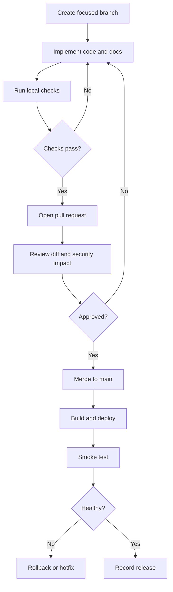

# 🚀 Release and change-management process

## Release principles

A release is a reviewed, reproducible change to the application. A green build is necessary but not sufficient. The current project has limited automated test coverage and known dependency-audit failures, so releases must not imply stronger assurance than the checks provide.

## Versioning

Use semantic versioning when the project begins publishing tagged releases:
- **MAJOR:** incompatible API or data contract change.
- **MINOR:** backward-compatible feature addition.
- **PATCH:** backward-compatible fix or security update.

Until formal tags are adopted, identify releases by the Git commit SHA and release date.

## Change workflow



## Required local checks

Backend:
```bash
cd backend
npm ci
npm test
node --check index.js
node --check routes/booksRoute.js
node --check models/bookModel.js
```

Frontend:
```bash
cd frontend
npm ci
npm run lint
npm run build
```

Run commands from the directories shown. Do not claim a check passed unless its actual exit status is successful.

## Pull request requirements

Every pull request should explain:
- What changed and why.
- User-visible behavior changes.
- API or data model changes.
- Security and privacy impact.
- Accessibility impact.
- Screenshots for material UI changes.
- Tests executed and their actual results.
- Deployment or migration requirements.
- Known limitations and rollback considerations.

Update the relevant documentation in the same change as the code.

## Database compatibility

Before changing the schema:
1. Document the old and new shape.
2. Identify whether existing documents remain valid.
3. Plan a migration or compatibility period.
4. Back up data before a destructive operation.
5. Test against a disposable copy.
6. Define rollback behavior.
7. Update API and data-model documentation.

The current Book model is small, but future migrations must not rely on undocumented manual database edits.

## Deployment and smoke tests

Deploy the frontend and API with matching environment configuration. Confirm database readiness before enabling traffic. After deployment, verify the public frontend, API readiness, and a safe read-only catalogue request. Use a dedicated test environment for mutation smoke tests.

## Rollback

Rollback should restore a known-good application build and compatible configuration. If a release includes a database migration, application rollback alone may not restore compatibility. Follow the migration's documented reverse or forward-fix strategy.

Record:
- Previous and new commit SHAs.
- Deployment time.
- Reason for rollback.
- User/data impact.
- Recovery action.
- Follow-up issue.

## Release checklist

- [ ] Scope and acceptance criteria are complete.
- [ ] Documentation is updated.
- [ ] Backend tests pass.
- [ ] Frontend lint and build pass.
- [ ] Dependency advisories are reviewed and dispositioned.
- [ ] Secrets and environment configuration are checked.
- [ ] Database migration and backup requirements are satisfied.
- [ ] Accessibility and responsive behavior are reviewed.
- [ ] Deployment and rollback steps are known.
- [ ] Smoke tests pass.
- [ ] Release commit and notes are recorded.
