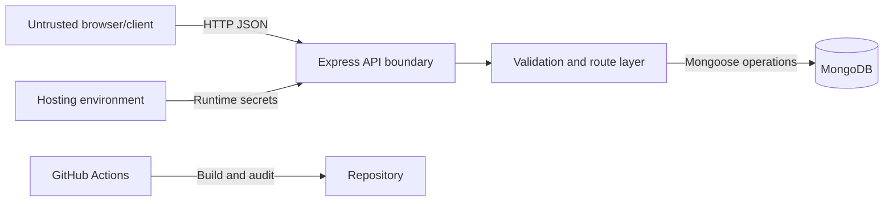

# 🛡️ Threat model and security boundaries

## Purpose

This lightweight threat model identifies realistic risks in the current catalogue application. It is a design aid, not a penetration-test report or a claim that the application is secure for public production use.

## System assets

- MongoDB credentials and database access.
- Book catalogue records.
- Application source and dependency integrity.
- Hosting environment variables.
- API availability and integrity.
- CI credentials and repository write permissions.

## Trust boundaries

The API must treat all incoming requests as untrusted, including requests from allowed CORS origins.

## Threat register

| Threat | Example | Existing mitigation | Remaining work |
|---|---|---|---|
| Credential exposure | MongoDB URI committed to Git | Current source uses environment configuration; secret scan workflow exists | Rotate the exposed credential and review historical access |
| Unauthorised writes | Anyone can call public CRUD routes | Payload validation and CORS allowlist | Add authentication and authorisation before public write access |
| Injection or malformed data | Unexpected types or fields in JSON | Allowlisted fields, type/length checks, Mongoose schema | Add route integration and fuzz tests |
| Denial of service | Excessive requests or huge payloads | JSON size limit | Add rate limiting, reverse-proxy limits, monitoring |
| Dependency compromise | Vulnerable or malicious npm package | Lockfiles, Dependabot, npm audit workflow | Resolve current high/critical advisories and review updates |
| Data loss | Accidental deletion or database failure | CRUD behavior only | Define backups, restore drills, and operator permissions |
| CORS misunderstanding | Treating origin allowlist as authentication | CORS configured centrally | Document that direct clients can still call API |
| Supply-chain workflow abuse | Untrusted pull request executes privileged workflow | CI uses repository workflows | Review permissions, pin actions, avoid exposing secrets to untrusted code |
| Information leakage | Logs include connection strings or request data | Environment-based configuration | Audit logging and redact sensitive values |

## Security controls already present

The current source includes server-side payload validation, a Mongoose schema, a bounded JSON parser, configured CORS origins, ObjectId validation, consistent error handling, and graceful process shutdown. These controls reduce specific risks. They do not replace identity, authorisation, rate limiting, backup operations, or dependency remediation.

## Priority remediation

### P0: Before public deployment

1. Rotate/revoke the previously committed MongoDB credential.
2. Create a least-privilege database user and restrict database network access.
3. Resolve high and critical dependency advisories in both package trees.
4. Do not expose unauthenticated write endpoints to the public internet.
5. Confirm production environment variables and CORS origins are correct.

### P1: Reliability and abuse resistance

1. Add API rate limiting and request correlation IDs.
2. Add route integration tests against an isolated test database.
3. Add backup retention and restore procedures.
4. Review GitHub Actions permissions and pin third-party actions to immutable commit SHAs.
5. Add dependency update review and a documented patch SLA.

### P2: Mature security posture

1. Add authentication and role-based authorisation if multi-user access is required.
2. Add security headers and a documented reverse-proxy configuration.
3. Add structured, redacted operational logs.
4. Add periodic dependency and configuration reviews.
5. Run an independent security assessment before handling sensitive data.

## Abuse cases to test

- Submit an unknown field such as `isAdmin`.
- Submit arrays/objects instead of strings.
- Submit excessively long title/author values.
- Submit negative, fractional, non-numeric, and future-out-of-range years.
- Submit malformed and valid-but-nonexistent ObjectIds.
- Send oversized JSON bodies.
- Call write endpoints from a non-browser HTTP client to verify that CORS is not mistaken for access control.
- Trigger database unavailability and verify the API does not report readiness.

## Review cadence

Review this threat model whenever the application adds user identity, file uploads, external integrations, payment-related behavior, new database collections, or public deployment. Revisit it at least once per major release.
